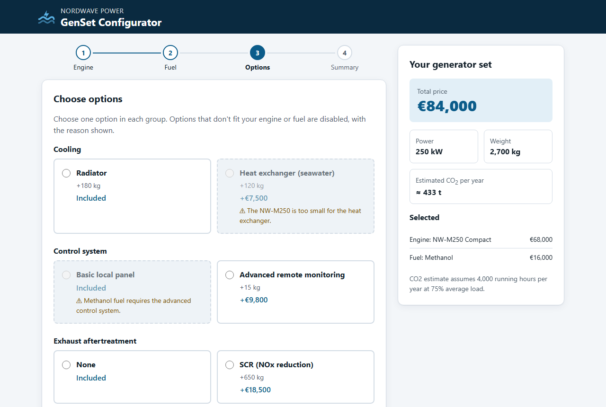
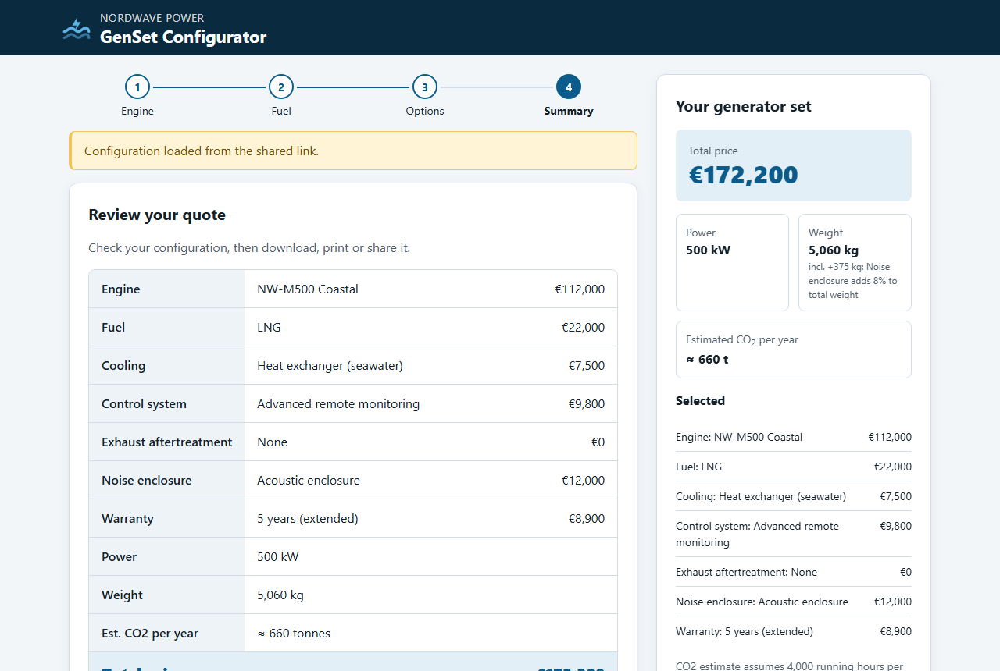
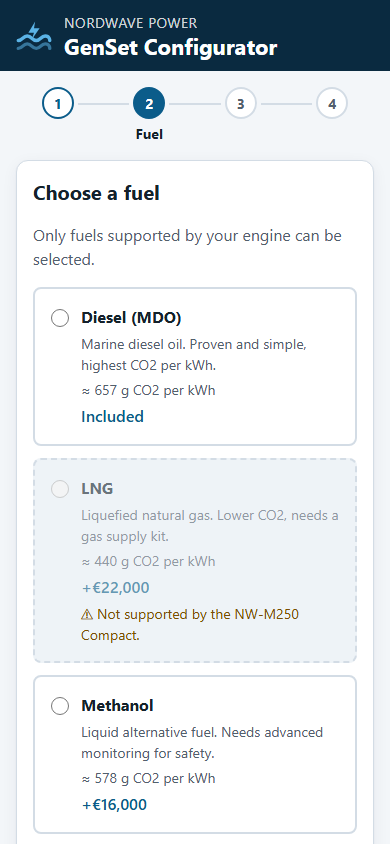
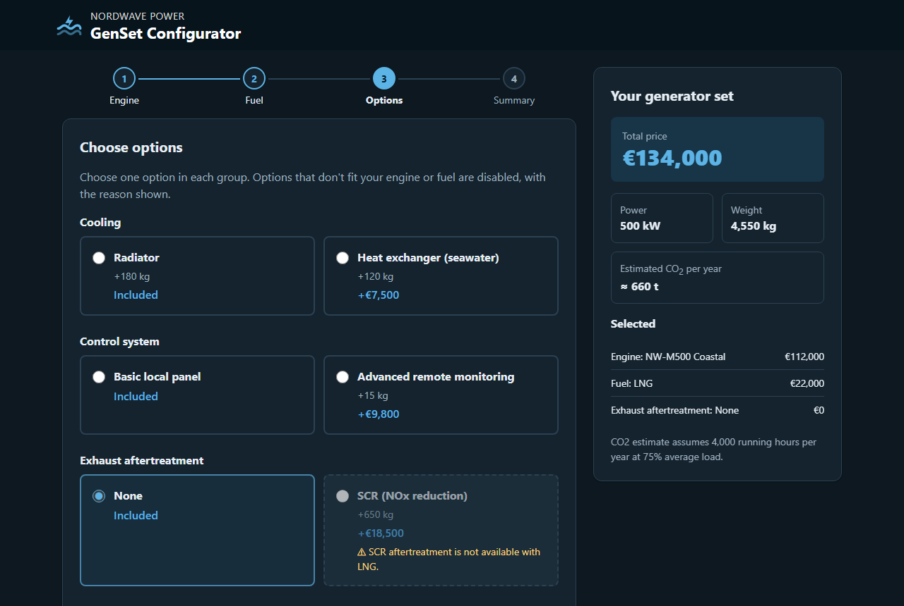

# GenSet Configurator

A web app for configuring a marine generator set: choose an engine, fuel and options, and see the price, weight and estimated CO2 update live. Incompatible combinations are blocked by a rule engine driven entirely by a JSON file.

Built with **plain HTML, CSS and vanilla JavaScript (ES modules)**. No frameworks, no build step, no dependencies.

**Live demo:** https://ahsan-babar-khan.github.io/genset-configurator/

> NordWave Power is a fictional company. All products, prices and CO2 figures are made up for this portfolio project.



| Quote summary | Mobile | Dark mode |
|---|---|---|
|  |  |  |

## Features

- **Step-by-step form:** Engine → Fuel → Options → Summary, with a progress indicator and Back/Next.
- **Data-driven:** every engine, fuel, option, price and rule lives in [`data/products.json`](data/products.json). Changing the JSON changes the app, with no code changes.
- **Rule engine:** incompatible choices are disabled with a visible reason. If an earlier change makes a later choice invalid, it is cleared and a notice explains why.
- **Live summary:** total price, power, weight (including percentage modifiers) and estimated annual CO2, updated on every change. Sticky on desktop.
- **Validation:** you can't continue without the required choices; missing groups are highlighted.
- **Save/load:** the configuration is saved in `localStorage` automatically (with full error handling).
- **Shareable link:** the URL always contains the configuration, e.g. `?engine=nw-m500&fuel=lng&...`. Links are treated as untrusted input and sanitized.
- **Export:** download the quote as JSON, or print a clean one-page quote (dedicated print stylesheet).
- **Accessible:** semantic HTML, labelled inputs, full keyboard support, visible focus, `aria-live` price updates. Zero violations in an axe-core audit (WCAG 2.1 AA) in light and dark mode.
- **Responsive and themed:** mobile-first CSS Grid/Flexbox layout, colours as CSS custom properties, automatic dark mode.

## How it works

```
user clicks a radio
  └─> main.js       event listener (wiring)
        └─> rules.js    applySelection(): pure, returns new selections + what was reset
              └─> state.js    stores selections, notifies subscribers
                    └─> main.js render()
                          ├─> pricing.js  calculateTotals(): pure
                          └─> ui.js       updates the DOM
```

| File | Responsibility |
|---|---|
| `data/products.json` | All product data: engines, fuels, option groups, compatibility rules, weight modifiers, CO2 assumptions |
| `js/main.js` | Loads the data and wires events, rules, state and UI together |
| `js/state.js` | Current configuration (observable store), localStorage save/load, URL encode/decode |
| `js/rules.js` | **Pure**: availability, rule engine, auto-reset, validation, data integrity check |
| `js/pricing.js` | **Pure**: price, weight, power, CO2 totals and the quote object |
| `js/ui.js` | All DOM rendering |
| `css/styles.css`, `css/print.css` | Screen and print styles |
| `tests/` | Unit tests for rules, pricing, state and the product data |

### Rules as data

```json
{
  "id": "no-scr-with-lng",
  "type": "excludes",
  "if":   { "group": "fuel", "value": "lng" },
  "then": { "group": "aftertreatment", "value": "scr" },
  "message": "SCR aftertreatment is not available with LNG."
}
```

Two rule types are supported: `excludes` (disable one option) and `requires` (only one option allowed in a group). The rule engine is a single generic loop, so a new rule is a JSON edit, not a code change.

## How to run

The app loads `products.json` with `fetch()` and uses ES modules, so it must be served over HTTP (opening `index.html` directly from disk won't work).

**VS Code:** install the *Live Server* extension, open the folder, and click **Go Live**.

**Or any static server**, for example:

```bash
npx serve .
# or
python -m http.server 8000
```

### Run the tests

Requires Node.js 20 or newer. No packages to install.

```bash
npm test
```

28 tests using Node's built-in test runner cover the rule engine, pricing, URL handling, state, and the product data itself. One data test checks that **every allowed engine + fuel combination can still be completed**, so a bad rule can't leave customers stuck.

## Deployment

Every push to `main` runs the tests in GitHub Actions ([`.github/workflows/deploy.yml`](.github/workflows/deploy.yml)). The site is deployed to GitHub Pages **only if the tests pass**.

## Git workflow

One commit per feature with conventional prefixes (`feat:`, `fix:`, `test:`, `docs:`, `chore:`). See the history with `git log --oneline`.

## What I learned

<!-- TODO (Ahsan): rewrite this section in your own words before sharing. -->

- **Separating data from code.** Putting products, prices and rules in JSON means a product manager can change the catalogue without a developer, and the code stays small and generic.
- **Pure functions are easy to test.** Keeping `rules.js` and `pricing.js` free of DOM code let me test them in Node in milliseconds, without a browser.
- **One-way data flow.** Rendering the UI *from* state, instead of reading state back out of the DOM, removed a whole class of out-of-sync bugs.
- **Never trust input you didn't create.** URLs and `localStorage` can be edited or corrupted, so both go through the same sanitizing as user choices, and all text is rendered with `textContent`.
- **Accessibility is mostly good HTML.** `<fieldset>`, `<legend>`, `<label>` and real radio buttons gave keyboard and screen-reader support almost for free; `aria-live`, focus management and visible reasons for disabled options did the rest.
- **Real bugs found by testing:** ES modules don't run from `file://`; `toISOString()` gives the UTC date, which named the downloaded file after the wrong day; a grid inside a full-height flex layout stretched its rows on mobile.

More detailed notes for each build stage are in [`docs/LEARNING-NOTES.md`](docs/LEARNING-NOTES.md).
